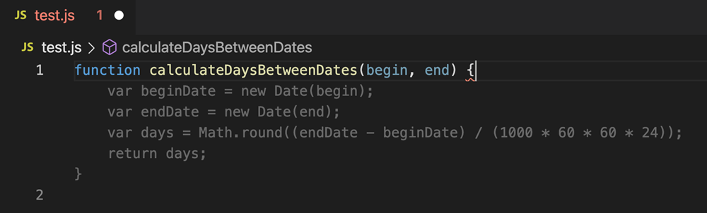
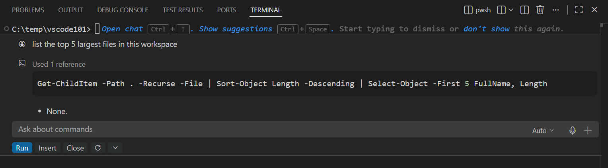
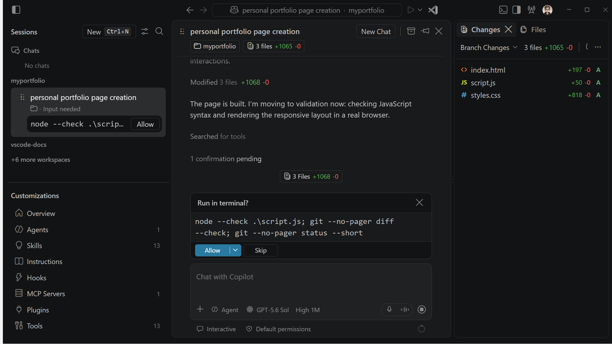

<!-- _class: cover -->
<!-- _paginate: false -->

АРХИТЕКТУРА ПО

# ИИ-ассистенты в разработке ПО

Влияние на архитектуру команд

---

<!-- _class: screenshot -->

## Автодополнение в редакторе

Серым показан код, который Copilot предлагает дописать.

---

<!-- _class: screenshot -->

## Чат с ассистентом

Copilot предлагает команду для поиска пяти самых больших файлов в проекте. Разработчик решает, запускать ли её.

---

<!-- _class: screenshot agent-shot -->

## Агент в VS Code

Агент создал три файла и запросил разрешение на запуск проверки.

---

<!-- _class: example -->

## Задача для агента

> При создании записи пустое название должно давать ответ HTTP 400. Добавь тест. Сохрани формат ответа при успешном запросе.

- **Агент** находит проверку в репозитории, правит её и запускает тесты.
- **Разработчик** проверяет ответ и при пустом названии, и при обычном запросе.

---

## Примеры GitHub и Spotify

### GitHub

Copilot убирает устаревшие флаги функций и открывает PR. Инженеры проверяют изменения и решают, можно ли их принять.

### Spotify

Honk готовил PR для перехода на новые версии наборов данных. Там, где не хватало автоматических тестов, команды вручную проверяли правки в своих репозиториях.

---

<!-- _class: stats -->

## Что изменилось после внедрения агентов

Через год после внедрения. Исследование охватило 655 компаний.

| +35,7% | +56,1% | +13,7% |
| :--- | :--- | :--- |
| Новых запросов на слияние (PR) | К среднему времени от открытия PR до слияния | Закрытых задач в Jira |

Число PR и задач измеряли на сотрудника в месяц. Рост числа закрытых задач статистически незначим при пороге 5%.

---

## Что меняется в команде

- **Команда сервиса** задаёт требования к правке агента и отвечает за её ревью и выпуск.
- **Платформенная команда** настраивает доступ агента к репозиториям и общие автоматические проверки.
- **Владельцы связанных сервисов** согласуют изменения API. Описание API и тесты в репозитории помогают агенту соблюдать договорённости.

---

<!-- _class: summary -->

## Как понять, что ассистент помог

Один сервис, сопоставимые задачи до и во время пилота.

- **Время до первого ревью** показывает, растёт ли очередь.
- **Время от коммита до выпуска** показывает, ускорилась ли поставка.
- **Доля выпусков, потребовавших вмешательства** помогает оценить стабильность.

> Польза для команды видна, когда проверенные изменения быстрее доходят до пользователей, а стабильность сохраняется.
